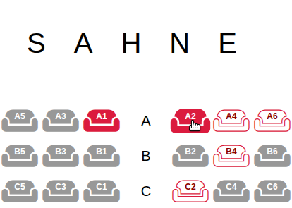

<h2>Theater Seat Picker</h2>

      
<b>EN: </b>A theater seat selection app. Pick seats on an interactive seating chart, with different prices for front and back rows and a live summary of your selected seats and total cost. Selections are limited to 8 seats, and pressing "Satın al" saves them in the browser so they are restored on your next visit. Built with HTML, CSS and vanilla JavaScript, with keyboard-friendly buttons and reduced-motion support. You can access via <a href="https://serkansarp.github.io/theater-seat-picker">Theater Seat Picker</a> link.

      

      
<b>TR: </b>Tiyatro koltuğu seçme uygulamasıdır. Etkileşimli salon planı üzerinden koltuk seçilir. Ön ve arka sıralar farklı fiyatlandırılır. Seçilen koltuklar ve toplam ücret anlık olarak gösterilir. En fazla 8 koltuk seçilebilir. "Satın al" ile yapılan seçim tarayıcıda saklanır ve sayfa yeniden açıldığında geri gelir. HTML, CSS ve vanilla JavaScript ile yazılmıştır. Klavye ile kullanıma uygundur ve hareketi azaltma tercihini destekler. <a href="https://serkansarp.github.io/theater-seat-picker">Theater Seat Picker</a> linki üzerinden ulaşabilirsiniz.

      
Serkan Sarp, 2026

      
<h6>Built with AI assistance. / Yapay zeka desteğiyle geliştirilmiştir.</small></h6>
